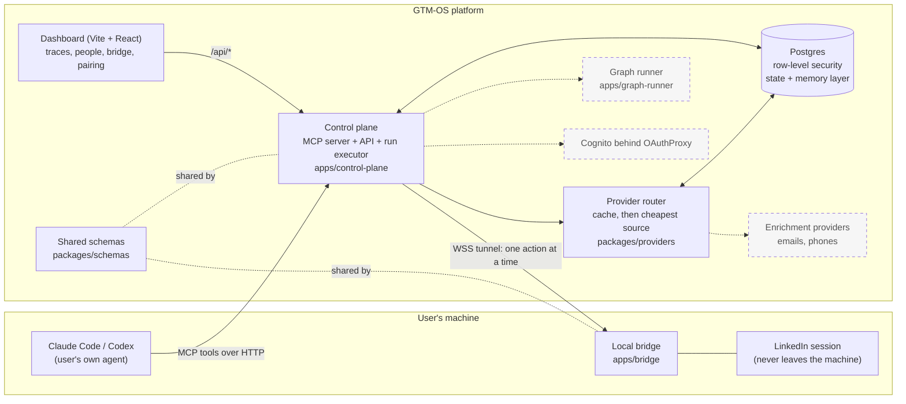
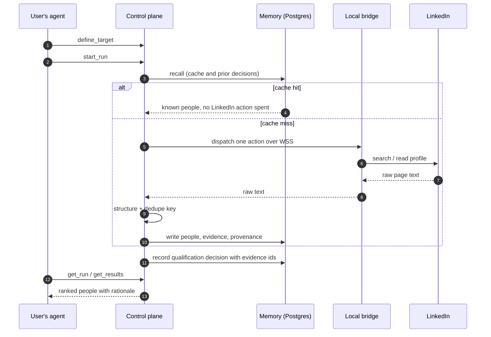
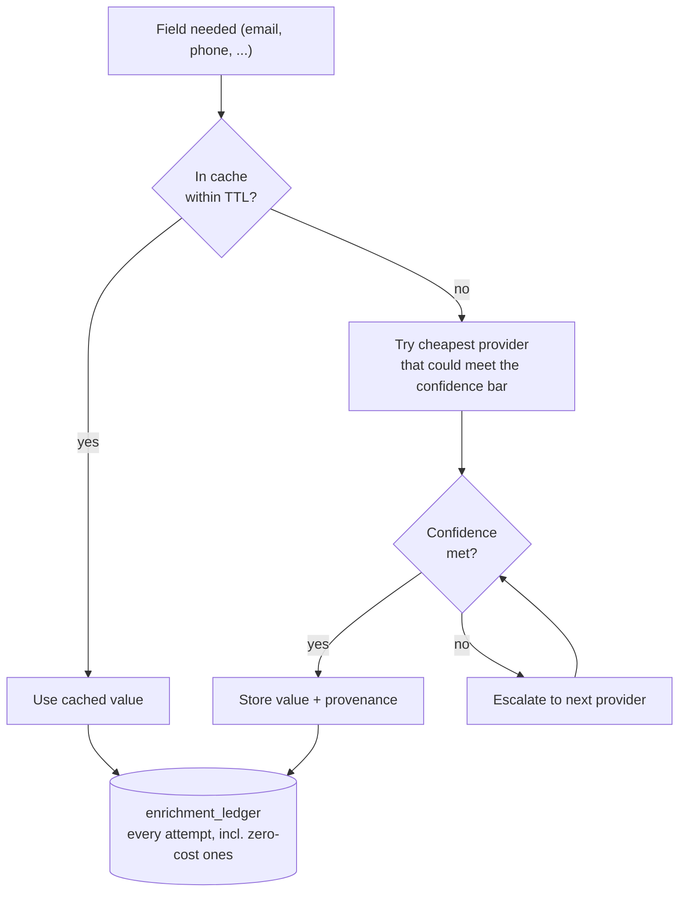
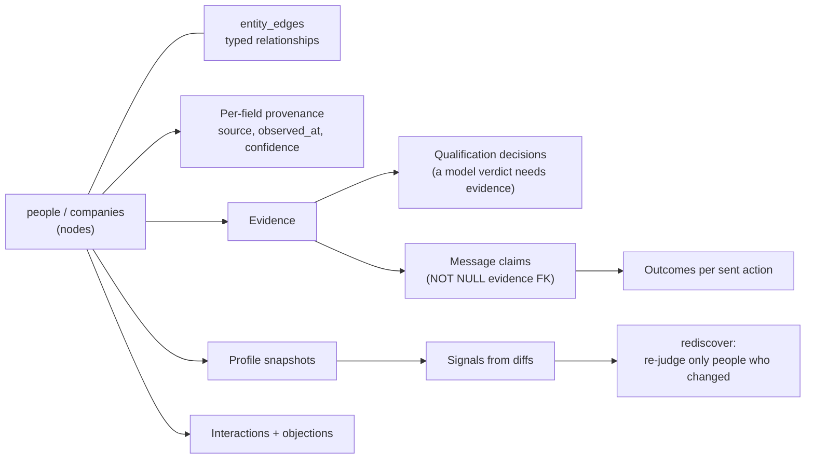

# Architecture

How GTM-OS fits together. Solid boxes are built and running locally; dashed boxes are
planned or not yet wired (see the status table in the README).

## System overview

## A sourcing run

## Enrichment routing

## Memory layer (the part that is the product)

## Design rules

1. One LinkedIn action at a time per user, so the cache is the throughput.
2. LinkedIn returns raw text, so structuring happens server-side to enable dedupe and caching.
3. A write must never happen twice (see `BRIDGE.md`).
4. Provenance is a schema constraint, not a prompt instruction (ADR-007 in `architecture-decisions.md`).

Full decision records: `architecture-decisions.md`, `bottlenecks.md`, `BRIDGE.md`.
